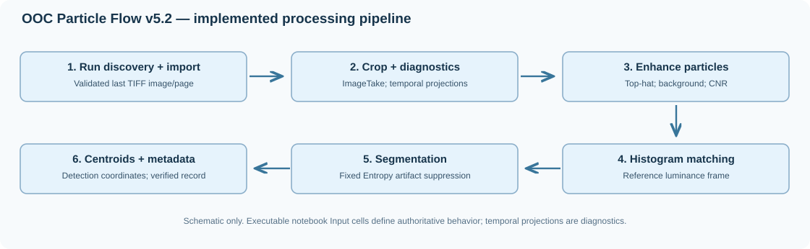

# Illustrated v5.2 processing pipeline

This guide describes the **implemented** OOC Particle Flow v5.2 stages. The diagram is an original schematic, **not** a representation of experimental pixel data.

| Stage | Notebook operation | Output |
| --- | --- | --- |
| **1. Discover + import** | Exact run prefix, numeric filename ordering and last TIFF image/page | `images` |
| **2. Crop + inspect** | `ImageTake`; separate chunked temporal projections | `croppedImages`, diagnostic images |
| **3. Enhance** | Morphological top-hat, interval-based temporal background correction, CNR enhancement | `imagesEnhanced` |
| **4. Deflicker** | Select the first qualifying mean-luminance reference and apply `HistogramTransform` | `imagesEnhancedMatched` |
| **5. Segment** | Temporal-mean artifact mask with **fixed Entropy**, per-frame `Binarize`, `DeleteSmallComponents` | `particleMasks` |
| **6. Centroids + provenance** | `ComponentMeasurements[..., "Centroid"]`, verified `ProcessingParameters.wl` export | `particleCentroids`, metadata |

## Important distinctions

**Temporal diagnostic projections** are not the data passed to the top-hat filter. Instead, the pipeline processes the original cropped image sequence; the persistent artifact mask is constructed from the *mean of histogram-matched enhanced frames*.

The artifact mask is computed with fixed `"Entropy"` independently of the selectable `segmentationMethod`. The optional channel-wall detector is not active in the default pipeline.

The notebook produces **per-frame detections, not linked PTV trajectories**. Tracking/MNNT headings preserved from older drafts are not a validated tracking implementation.

## From figures to reproducibility

- [Parameter-by-parameter reference](../reference/parameters.md) explains the actual v5.2 settings.
- [Annotated WL excerpts](../reference/wolfram-examples.md) connect operations to notebook Input cells.
- [Synthetic sequence tutorial](../tutorials/synthetic-sequence.md) provides independently runnable Wolfram code.
- [Real 100-frame Run 1 example](../tutorials/real-run1.md) records exact raw/crop matches and historical-v5 count agreement.
- [Validation limits](../validation/index.md) distinguish pixel, component-count and centroid equivalence.
