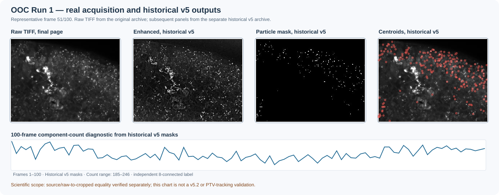

# Real Run 1 — 100-frame image-processing case

This is an authentic experimental input with a carefully documented **historical-v5 versus v5.2** boundary.

The private research repository stores the 100-TIFF **`Raw_images_for_testing.7z`** archive and the corresponding **`run1_mucins_oste.7z`** historical processed archive. The latter contains 100 cropped, enhanced and particle-mask frames from **v5**, not freshly executed v5.2 outputs.

## What has been verified?

An independent read-only decoder inspected the last TIFF page in each DynamicStudio file. Its uncompressed strips form a single `uint16` plane of **1024 × 1344** pixels. The stored `ImageDepth=12` metadata can mislead generic readers into interpreting a nonexistent 12-plane volume.

- **100/100** raw final-page TIFF arrays exactly match archived historical v5 cropped TIFFs.
- An independent 8-connected-component measurement on the **100 historical v5 masks** now agrees with **100/100 saved Run 2 Mathematica detection counts**, including frame 28 = **207**.
- The 100-frame total is **21,322** detected components.

This is stronger **count-level evidence** than the older 99-point PDF plot comparison. It is **not** proof of equal v5/v5.2 mask pixels or identical centroid coordinates.

## Reproducing the current v5.2 run locally

1. With authorized Git LFS access, retrieve the raw archive from the private repository and check its SHA-256 against the private manifest.
2. Extract to a short local Windows folder. Do not rewrite original TIFF headers or pixel arrays.
3. Open `OOC_Particle_Flow_v5.2.nb` alongside `TemporalProjections_v1.1.0.wl` in Mathematica.
4. In **Import Images**, set `imageFolder` and `subFolder`; discover the run prefix `mucini_oste220_1_01`, then select its integer `runIndex`.
5. Evaluate the crop, top-hat, temporal background correction, particle CNR, histogram matching, fixed-Entropy artifact mask, frame segmentation and centroid-extraction cells.
6. Save the enhanced/mask images and centroid records intentionally. Export and verify a fresh `ProcessingParameters.wl` association.

The native **Run 3** already completed 100-frame processing under Windows Mathematica 12.1.1 and exported a verified 17-field processing record with reference frame 12. A historical v5 image should **never** be relabeled as a v5.2 image.

## Approved experimental figure

*Figure 1.* Real Run 1 frame 51. The enhanced frame and mask are **historical v5** outputs, not a fresh v5.2 run. Centroids and the 100-frame count series were independently computed from the historical masks. Count agreement does not establish v5/v5.2 pixelwise or centroid equivalence.

**All rights reserved — figure-specific permission.** Publication of this reduced-resolution montage on this website is expressly authorized. The experimental pixels and derived figure are **excluded from the MIT license**. Reproduction, adaptation, or redistribution requires permission from the relevant rights holder(s). Raw TIFFs and full processed archives remain private.

**Data provenance and attribution:** Experimental data ©/owned by **Institute of Solid State Physics (ISSP), University of Latvia**; principal experimental contributors **Betija Ziediņa** and **Gunita Kojāne**. The data were shared with **Mihails Birjukovs, Institute of Numerical Modelling (INM)** for code development and verification. **ISSP approved publication of this specific reduced-resolution worked example**, including so that Betija could use the documentation with examples. This authorization does not extend to the full raw/processed archives or additional experimental figures. See [Credits & data provenance](../credits/index.md).

For a fully open, executable image-analysis demonstration, follow the [synthetic-sequence tutorial](synthetic-sequence.md).
